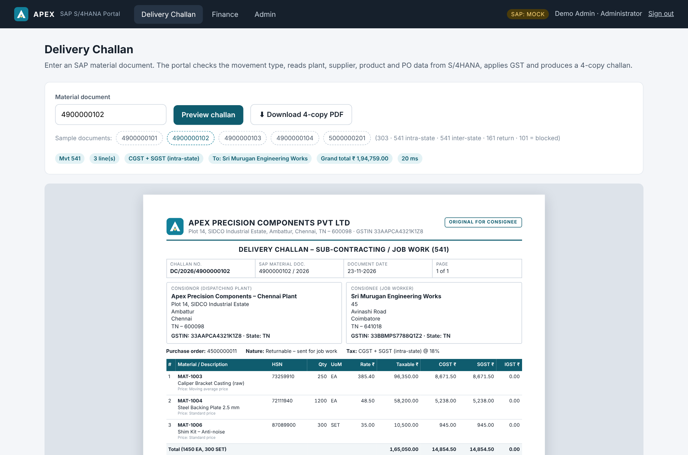
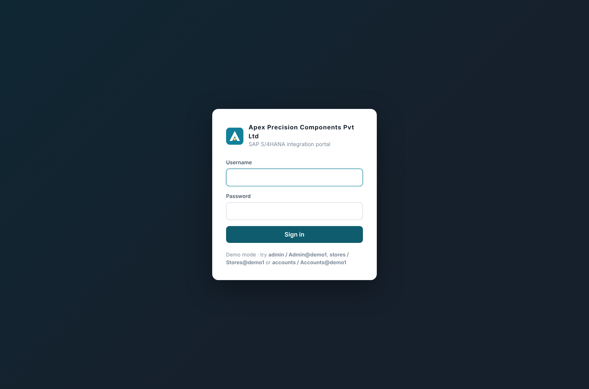
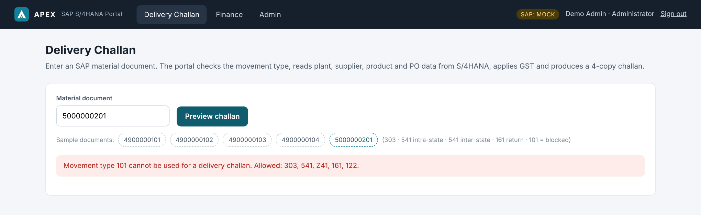
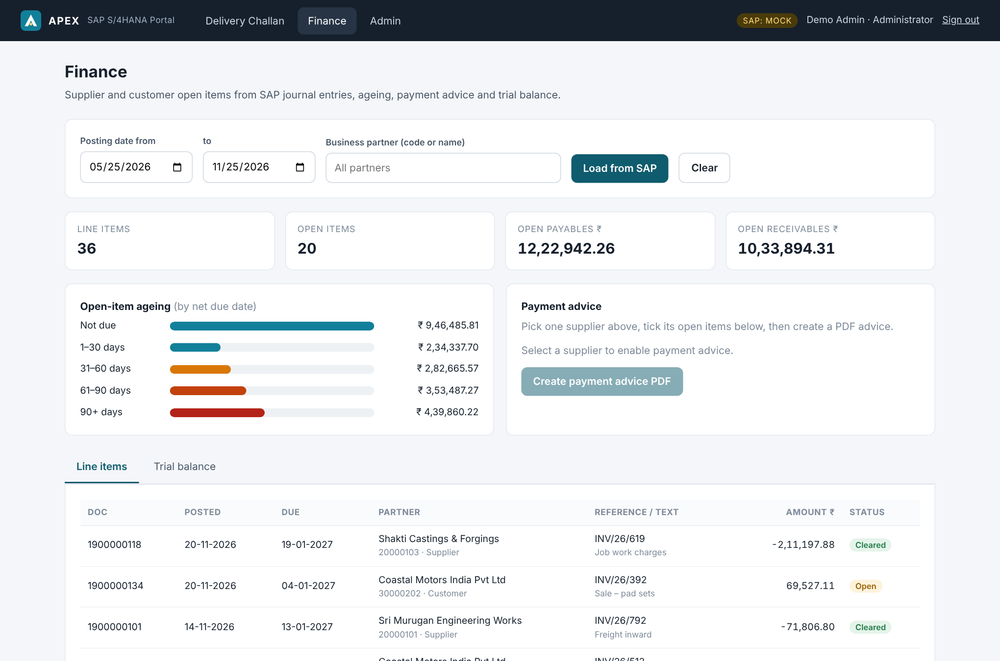
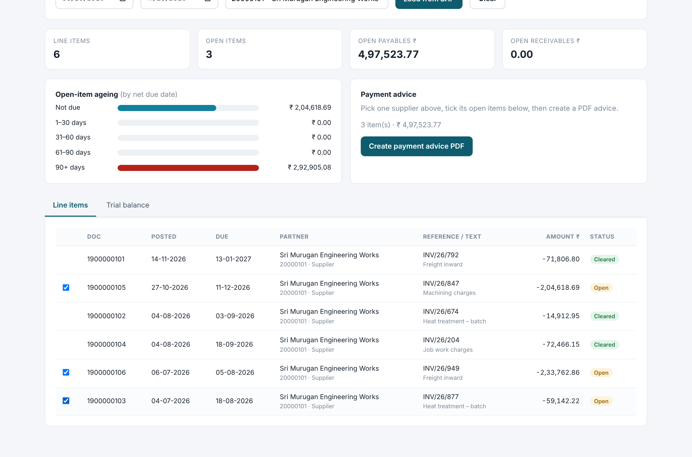
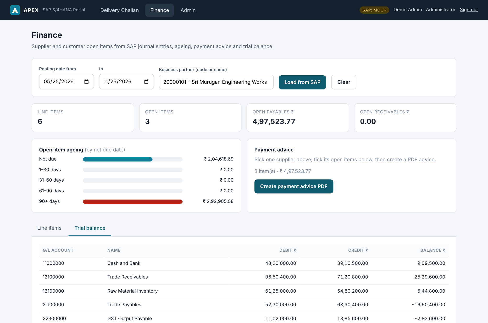
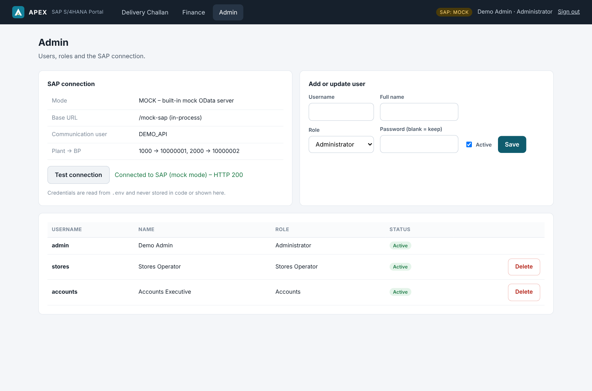

# SAP S/4HANA Integration Portal – Demo

A Python/Flask web portal that reads live data from **SAP S/4HANA OData APIs** and produces
GST-compliant business documents for an Indian manufacturing company.

> **Demo project.** "Apex Precision Components" and all partners, GSTINs and amounts are fictional.
> A built-in **mock SAP OData server** returns realistic data, so the portal runs without any SAP system.
> Switch `SAP_MODE=live` to connect to a real S/4HANA Cloud tenant – no code changes needed.



## Features

**Delivery challan (Inventory / MM)**
- Validates the SAP material document's movement type: 303 inter-plant, 541/Z41 job work, 161/122 return to vendor; anything else (e.g. 101) is blocked with a clear message
- Reads plant and supplier address + GSTIN from Business Partner, product description, valuation price (standard → moving average fallback), HSN from plant foreign-trade data
- Return challans are priced from the purchase order net price
- Automatic **CGST + SGST** (same state) or **IGST** (inter-state), amount in words (Lakh/Crore)
- Live preview, then a 4-copy A4 PDF (Original / Duplicate / Triplicate / Extra) with page overflow

**Finance (FI)**
- Supplier/customer line items from journal entries, filtered by date and partner (with autocomplete)
- Open payables/receivables and ageing buckets (not due, 1–30, 31–60, 61–90, 90+)
- Payment advice PDF for selected open supplier invoices (amounts re-read from SAP, never trusted from the browser)
- Trial balance

**Platform**
- Role-based access (Admin, Stores Operator, Accounts), hashed passwords, CSRF protection
- SAP credentials only in `.env` – never in code
- Parallel SAP calls (ThreadPoolExecutor) + TTL cache for master data; preview in ~20 ms on mock
- Safe OData literal escaping (no `$filter` injection)
- 21 automated tests (pytest)

## SAP APIs used

| Purpose | Service / entity set |
|---|---|
| Movement type, document + items | `API_MATERIAL_DOCUMENT_SRV` · `A_MaterialDocumentHeader`, `A_MaterialDocumentItem` |
| Plant / supplier address, GSTIN | `API_BUSINESS_PARTNER` · `A_BusinessPartner`, `A_BusinessPartnerTaxNumber` |
| Description, price, HSN | `API_PRODUCT_SRV` · `A_ProductDescription`, `A_ProductValuation`, `A_ProductPlantIntlTrd` |
| PO price / supplier | `API_PURCHASEORDER_PROCESS_SRV` · `A_PurchaseOrder`, `A_PurchaseOrderItem` |
| AP/AR line items | `API_OPLACCTGDOCITEMCUBE_SRV` · `A_OperationalAcctgDocItemCube` |
| Trial balance | `C_TRIALBALANCE_CDS` · `C_TrialBalance` (simplified in the mock) |

## Quick start (Windows)

```bat
cd sap-s4-portal-demo
python -m venv venv
venv\Scripts\activate
pip install -r requirements.txt
python -m playwright install chromium
copy .env.example .env
python run.py
```

Open http://127.0.0.1:5000 and sign in:

| User | Password | Role |
|---|---|---|
| admin | Admin@demo1 | Administrator |
| stores | Stores@demo1 | Stores Operator |
| accounts | Accounts@demo1 | Accounts |

Try documents `4900000101` (303), `4900000102` (541, CGST+SGST), `4900000103` (541, IGST),
`4900000104` (161 return) and `5000000201` (101 – blocked).

Run tests: `pytest`  ·  Production server: `python serve.py` (Waitress)

## Connect to a real S/4HANA system

1. In S/4HANA create a communication user + arrangement exposing the APIs above (read access).
2. In `.env`: `SAP_MODE=live`, `SAP_BASE_URL=https://<tenant>-api.s4hana.cloud.sap`, `SAP_USER`, `SAP_PASSWORD`, `PLANT_TO_BP`.
3. Admin → **Test connection**.

## Project structure

```
portal/
  app.py          Flask app factory and routes
  sap_client.py   OData V2 client: auth, escaping, caching, errors, HTTP or in-process transport
  challan.py      material document → challan data (movement rules, pricing, HSN, GST)
  finance.py      line items, ageing, party search, trial balance
  gst.py          CGST/SGST/IGST split, amount in words, Indian number format
  auth.py         users (hashed), roles, CSRF
  pdf.py          HTML → PDF via headless Chromium
mock_sap/
  server.py       mock OData V2 server ($filter parser, $select, $expand, $orderby, $top, Basic auth)
  data.py         fictional master and transaction data
templates/        UI pages and printable documents
tests/            pytest suite
docs/             screenshots and sample PDFs
```

## Screenshots

| | |
|---|---|
|  |  |
|  |  |
|  |  |

Sample output: [4-copy challan PDF](docs/sample_challan_541.pdf) · [payment advice PDF](docs/sample_payment_advice.pdf)

## Licence

MIT – free to use as a reference.
